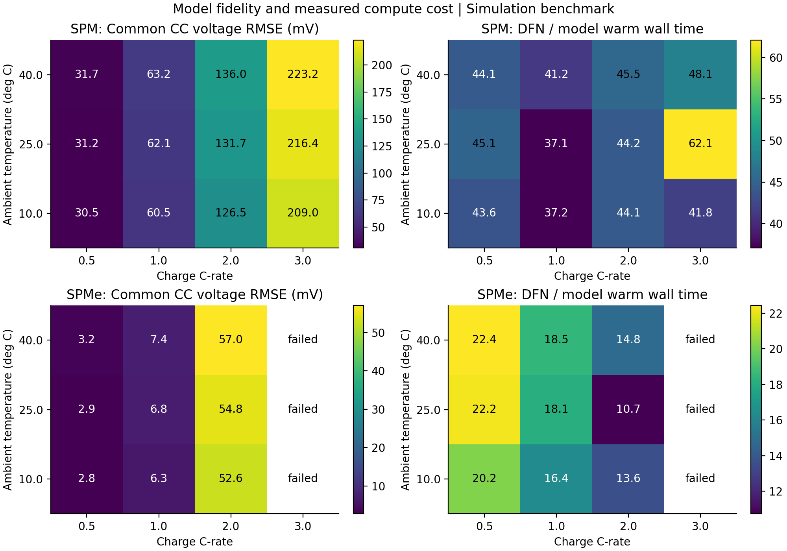

# PyBaMM Battery Management — MECHENG 754 Capstone

This package provides a runnable SPM/SPMe/DFN charging comparison using Chen2020 parameters and a lumped thermal model, with numerical checks, operating-condition sweeps, measured-discharge comparisons and team task assignments.

The **2026-11-24 release** fixes the SOC contract, failure/accuracy classification,
trace precision and provenance. It adds an explicitly configured transport variant,
a bounded model-fidelity lookup and a separately labelled single-charge degradation
illustration. See [release changes and verification](docs/RELEASE_20261124_EN.md) and
[the open research objectives and implementation route](docs/IMPLEMENTATION_EVIDENCE_EN.md).

All deliverables are in English except [GUIDE_ZH_EN.md](docs/GUIDE_ZH_EN.md), which retains Chinese–English parallel explanations.

## Start here

1. Read [ABSTRACT_REVIEW_EN.md](docs/ABSTRACT_REVIEW_EN.md) for the scope decision and replacement abstract.
2. Read [GUIDE_ZH_EN.md](docs/GUIDE_ZH_EN.md) for the detailed bilingual workflow and portable setup commands.
3. Open [RELEASE_20261124_EN.md](docs/RELEASE_20261124_EN.md) for current results; [RESULTS_SUMMARY_EN.md](docs/RESULTS_SUMMARY_EN.md) preserves the November 17 results and their nominal-SOC convention.
4. Share [TEAM_TASKS_EN.md](docs/TEAM_TASKS_EN.md) with your two teammates, together with this package.

## Included results

The original production sweep completed **33 of 36 cases**. SPMe at 3C failed at all three temperatures (10, 25 and 40 degrees C); the original failure records are retained. The new release contains fresh runs under `results/release_20261124/`, with five retained warm repetitions per completed sweep case. Completed runs and models passing the accuracy screen are counted separately. Historical data remain in their original directories, with one explicitly archived timestamp repair.



## Files

| File or folder | Purpose |
|---|---|
| `run_study.py` | Three-model CC-CV simulations, metrics, timing and convergence |
| `study_contract.py` | Shared parameters, SOC basis, trace reader and accuracy rules |
| `select_model.py` | Model-fidelity lookup at verified grid points only |
| `run_degradation_demo.py` | One illustrative charge with SEI and partially reversible plating |
| `verify_release.py`, `test_contracts.py` | Release evidence audit and interpretation regression checks |
| `plot_results.py` | Figures from exported charging results |
| `prepare_data.py` | Source checksum validation, data cleaning and step inventory |
| `validate_data.py` | Unfitted model-to-measurement discharge comparisons |
| `diagnose_spme.py` | Separate mesh/tolerance investigation of incomplete 3C cases |
| `audit_physics.py` | Positive-electrolyte check for completed production cases |
| `plot_validation.py` | Experimental comparison plots |
| `configs/` | Baseline and 36-case sweep configurations |
| `requirements-lock.txt` | Exact installed dependency versions |
| `setup.ps1` | Teammate environment setup; equivalent manual commands below |
| `data/raw/` | Three unchanged public LG M50 source files and repository metadata |
| `data/processed/` | Normalized current signs, quality audit and step inventory |
| `results/sweep/` | Production simulation results, configuration and environment |
| `results/release_20261124/` | Current charging, numerical, measured-data and demo results |
| `results/convergence_refined/` | Accepted production-grid numerical checks |
| `results/validation_1C/` | Three-cell measured 1C discharge comparison |
| `results/baseline/`, `results/convergence/` | Earlier coarser deployment checks, retained as audit history |
| [SOURCES.md](docs/SOURCES.md) | Primary references and evidence boundaries |

## Fresh environment

The original study was tested on Windows with Python 3.10.11. Clone this repository and run all commands from its root directory:

```powershell
git clone https://github.com/JayGeraint/Pybamm-Battery-Management-MECHENG-754-Capstone.git
cd Pybamm-Battery-Management-MECHENG-754-Capstone
python -m venv .venv
.\.venv\Scripts\python.exe -m pip install -r requirements-lock.txt
.\.venv\Scripts\python.exe run_study.py --config configs/baseline.json --out results/my_baseline
.\.venv\Scripts\python.exe plot_results.py results/my_baseline
```

No activation or execution-policy change is required. The packaged virtual environment is not distributed; each teammate creates their own.

## Full run

For a routine run without the known 3C stress-case failures, use `--config configs/core.json` (27 combinations already exercised successfully in the full sweep). The full matrix intentionally retains the failed stress cases as research evidence.

```powershell
.\.venv\Scripts\python.exe run_study.py --config configs/baseline.json --convergence --out results/my_convergence
.\.venv\Scripts\python.exe run_study.py --config configs/sweep.json --out results/my_sweep
.\.venv\Scripts\python.exe plot_results.py results/my_sweep
.\.venv\Scripts\python.exe prepare_data.py
.\.venv\Scripts\python.exe validate_data.py --steps 17 --out results/my_validation
.\.venv\Scripts\python.exe plot_validation.py results/my_validation
```

Choose new output folder names on each run. Failed cases are recorded and produce a nonzero process exit. Inspect them before interpreting a summary.

## Interpretation

Voltage error is primarily reported over the common CC interval; CV voltage is imposed by the controller. DFN is a numerical reference. New charging-time metrics use the beginning-of-life electrode-window capacity (about 5.153198 Ah), consistent with the initial SOC convention; the nominal 5 Ah proxy remains explicitly available for historical comparison. The C-rate current definition remains 1C = 5 A. This terminal-charge SOC formula is restricted to the benchmark without degradation.

Runtime is a repeated warm simulation measurement on this machine, with build and first-solve cost reported separately. The default remains plain Chen2020. `configs/transport_variant.json` replaces four transport functions with their OKane2022 counterparts; it does not enable degradation or prove those parameters fit this cell. The separate demo uses full OKane2022 and is not a calibrated ageing model. Degradation identification, validated cycle life and charge optimization remain incomplete.

```powershell
.\.venv\Scripts\python.exe -m unittest test_contracts -v
.\.venv\Scripts\python.exe verify_release.py
.\.venv\Scripts\python.exe select_model.py results/release_20261124/sweep --rate 1 --temperature 25
.\.venv\Scripts\python.exe run_study.py --config configs/transport_variant.json --out results/my_transport
.\.venv\Scripts\python.exe validate_data.py --config configs/transport_variant.json --out results/my_transport_validation
.\.venv\Scripts\python.exe run_degradation_demo.py --out results/my_degradation_demo
```

The selector refuses nonfinite or untested conditions and benchmarks with fewer than five repeats. It ranks eligible models by measured warm solve time only; it is not a charging optimizer or an operating-safety assessment. The release audit requires a Git checkout and the exact locked environment. Use `--write-audits` only after reviewing intentional release changes.

Experimental files are CC BY 4.0, with attribution and modification notes in `data/README.md`. Do not redistribute the original user report or personal details with this package; they are not included.

## Repository organization and reproducibility

- `docs/` contains the research scope, bilingual guide, results summary, team plan and references.
- Python entry points remain at the repository root so their existing data paths and commands continue to work.
- `data/` and `results/` retain the supplied datasets, figures and numerical evidence.
- `verification.json` and `LANGUAGE_AUDIT.json` describe the current release. Their original versions are retained in `docs/history/`; `parameter_audit.json` remains the historical plain-Chen2020 audit.
- `MANIFEST_SHA256.json` records the SHA-256 of every distributed file except itself and Git metadata. Run environments additionally record source/configuration hashes.
- Local environments, caches, credentials and new `results/my_*` runs are excluded by `.gitignore`. Use those output names for local experiments; intentionally tracked study results remain in Git.

See [repository preparation notes](docs/REPOSITORY_PREPARATION.md) for the changes and checks performed during upload preparation.
