# 0. 一句话结论

**SPMe 在电解液没有耗尽之前几乎和 DFN 一样准（电压差 ≤ 16 mV，温度差 ≤ 0.8 K），而且快 3–4 倍；一旦 DFN 预测电解液严重耗尽（最低浓度 < 约 150 mol/m³），SPMe 会突然失效，这时必须用 DFN。SPM 在快充时从来不完全适用：电压差最高 158 mV，温度低估最多 24 K，而且在 69 个有析锂风险的工况里漏掉了 48 个。**

这句话就是整篇报告的核心，摘要、PPT 和结论都围绕它展开。

# 1. 先看哪些文件

整个项目都在 `SEP798_FastCharge_ModelFidelity` 这一个文件夹里。

| 文件 | 用途 |
|---|---|
| `docs/项目说明_中文.md`（或 `.docx`） | 本文档：做了什么、怎么做的、结果、局限性、报告怎么写 |
| `docs/SEP798_PlanA_Model_Fidelity.pptx` | 17 页演示文稿，正文英文，每页“备注”里有中文讲解，可以直接用来准备 20 分钟的 presentation |
| `docs/Revised_Abstract.md` | 按方案 A 重写的英文摘要（长版和短版）+ 每个数字的出处 + 与你原摘要的不一致之处 |
| `figures/fig01…fig11*.png` | 所有图（200 dpi），可以直接放进报告 |
| `results/*.csv` | 所有数值结果，报告里的每个数字都能在这里查到 |
| `src/*.py` | Python / PyBaMM 代码 |
| `matlab/*.m` + `results/matlab/*.mat` | MATLAB 后处理脚本和数据（已经在 Octave 里测试过可以运行） |
| `README.md` | 文件夹结构和如何重新运行 |

# 2. 研究问题和范围

## 2.1 研究问题

> 对一颗商用 21700 电池（LG M50，PyBaMM 的 Chen2020 参数，不做标定），在不同倍率和环境温度的 CC-CV 快充下，SPM 和 SPMe 什么时候不再能替代 DFN？每个模型能省多少计算时间？

## 2.2 方案 A 保留了什么、删掉了什么

| 保留（实际做了） | 删掉（不适合 capstone 的工作量，放到 future work） |
|---|---|
| SPM / SPMe / DFN 在同一平台（PyBaMM）上比较 | SEI 生长、析锂动力学、容量衰减 |
| 快充：CC-CV，0.5C–3C，0–40 °C | 衰减参数的可辨识性分析 |
| 精度与求解时间的权衡，定量化 | 用容量衰减轨迹和 IC 曲线标定 DFN |
| 负极/隔膜界面电位作为**析锂风险指标**（不是析锂模型） | 衰减拐点（循环次数）预测 |
| 21700（LG M50 / M50T）和端电压验证 | 15 分钟充到 80% 的多阶段恒流优化 |
| **新增**：集总热模型、恒流放电、UDDS 工况、冷却敏感性 | |

# 3. 方法

## 3.1 三个模型

三个模型都是 PyBaMM 自带的，区别在于“简化了多少物理”：

- **DFN（Doyle–Fuller–Newman，基准模型）**：沿电极厚度方向 x 分辨很多个颗粒，每个颗粒内部求解锂的扩散；同时求解电解液浓度 c_e(x,t) 和电解液电位 φ_e(x,t)。反应沿厚度方向不均匀。最准，但最慢。
- **SPMe（带电解液的单颗粒模型）**：每个电极只用一个“平均颗粒”，但额外求解电解液浓度，并把电解液的浓度过电位和欧姆压降作为修正项加到端电压上。它假设**反应沿电极厚度是均匀的**。
- **SPM（单颗粒模型）**：每个电极只有一个平均颗粒，**完全没有电解液动态**（没有电解液浓度变化，没有电解液欧姆压降）。最快，但物理最少。

三个模型都用 `{"thermal": "lumped"}` 耦合同一个**集总（0-D）热模型**：整个电池一个温度，产热 = 不可逆热（过电位）+ 可逆热（熵）+ 欧姆热，散热 = h·A·(T − T_amb)。默认 h = 10 W/m²K（自然对流，Chen2020 默认值）。

## 3.2 参数

- 参数集：PyBaMM 的 **Chen2020**（LG M50，NMC811 正极 / 石墨-SiOx 负极，标称 5 Ah），**不做任何标定**。
- 重要修改：原版 Chen2020 里，交换电流密度已经随温度变化（Arrhenius），但**颗粒扩散系数、电解液扩散系数和电导率是不随温度变化的**。如果不改，扫描环境温度就没有意义（低温下传输不会变慢）。所以我把这四个参数换成了 PyBaMM 自带的、**同一个来源的 Arrhenius 版本**（来自 OKane2022 参数集）：负极扩散 E_a = 30.3 kJ/mol，正极扩散 E_a = 25 kJ/mol，电解液用 Nyman 2008 的 Arrhenius 版本。代码在 `src/battery.py` 的 `get_parameters()`。报告里要写这一点。
- 网格：默认每个区域 20 个点；求解器 IDAKLU，三个模型用**完全相同的容差**（rtol = 1e-6，atol = 1e-8），这样计时比较才公平。

## 3.3 工况

| 工况 | 条件 | 次数 |
|---|---|---|
| CC-CV 充电（主研究） | 0.5C–3C（步长 0.25C，共 11 个）× 环境温度 0–40 °C（步长 5 °C，共 9 个）；从 10% SOC 恒流充到 4.2 V，再恒压到电流 < C/20 | 99 × 3 = 297 |
| 恒流放电 | 0.5C、1C、2C、3C × 0–40 °C；从 100% SOC 放到 2.5 V | 36 × 3 = 108 |
| UDDS 行驶工况 | 课程 Assignment 2 的 UDDS 电流（按 5/5.4 换算到 5 Ah 电池），×1 和 ×2 负载，从 80% SOC 连续 4 个循环（约 91 分钟），0/10/25/40 °C | 8 × 3 = 24 |
| 冷却敏感性 | 同样 99 个充电工况，h = 50 W/m²K（强制风冷） | 99 × 3 = 297 |
| 实测验证 | LG M50T：C/10 放电、0.5C 混合脉冲放电（25 °C），原始和容量对齐两种 | 2 × 3 × 2 = 12 |
| 检查 | 计时基准（6 个工况 × 3 个模型 × 重复 5 次）、DFN 网格加密检查（4 个工况） | 约 100 |

总共 800 多次仿真。

## 3.4 误差指标和“是否适用”的判定

以 DFN 为“真值”，SPM 和 SPMe 分别算以下误差（代码在 `src/metrics.py`）：

- 端电压 RMSE（充电只算 DFN 的恒流段，因为恒压段电压被固定在 4.2 V，会掩盖误差）
- 峰值温度误差 ΔT_peak
- 充到 80% SOC 所需时间的误差（%）
- SOC / 容量误差
- 负极在隔膜处的电位误差（析锂指标）
- 求解时间

判定标准（在 `src/config.py` 里可以改）：

| 指标 | 适用（绿） | 勉强（黄） | 不适用（红） |
|---|---|---|---|
| 电压 RMSE | ≤ 20 mV（约 3.7 V 的 0.5%） | ≤ 40 mV | > 40 mV |
| 峰值温度误差 | ≤ 2 K | ≤ 4 K | > 4 K |
| 80% SOC 时间误差 | ≤ 5% | ≤ 10% | > 10% |

所有指标都满足才算“适用”。另外有第四类**“模型失效”（灰色）**：求解器报错、电解液浓度变成负数（非物理），或者提前截止导致充/放电量少了一半以上。

## 3.5 析锂风险指标

用 DFN 输出的“负极在隔膜界面处的表面电位差”φ_s − φ_e（相对 Li/Li⁺）。**当它小于 0 V 时，热力学上锂金属可以在石墨表面析出**，所以把它当作析锂风险指标。隔膜处是负极最容易析锂的位置。

注意：这只是**风险指标**，没有析锂反应模型，不能说析了多少锂。SPM/SPMe 没有沿厚度的分布，它们给出的是“平均电位”或近似值，这正是要比较的：降阶模型会不会漏报风险。

## 3.6 计算时间

计时单独串行运行（没有其他任务干扰），每个工况每个模型重复 5 次，去掉第一次（包含首次编译/加载），取中位数。记录两个时间：

- **求解器时间（solve time）**：只算时间积分器里面的时间。这是报告里主要用的加速比。
- **总时间（wall time）**：包括建模、离散化、求解器初始化。单次仿真时这部分固定开销占比很大。

计时工况都选在 SPMe 能正常求解的区域里，避免把“提前失败”的短时间算成“快”。

## 3.7 实测验证

数据：LG M50T 电池 D（25 °C），C/10 恒流放电和 0.5C 混合恒流-脉冲放电，有电压、电流和表面温度（来源见 `data/m50t/SOURCE.md`）。把实测电流输入三个模型，比较端电压和温度。

Chen2020 模型的 C/10 容量是 5.13 Ah，而这颗实测电池只有 4.85 Ah（第二次测试 4.56 Ah，因为已经循环过）。所以有两种比较：

- **原始（raw）**：直接用实测电流。
- **容量对齐（capacity-aligned）**：把实测电流乘以容量比 k = 5.13 / 4.85 = 1.06（脉冲测试 1.127）。只调一个标量，不改任何动态参数，目的是去掉“容量不同”这个因素，看剩下的误差。

温度比较用原始电流，因为产热取决于真实电流。

# 4. 结果

## 4.1 三个模型在 CC-CV 充电时的表现

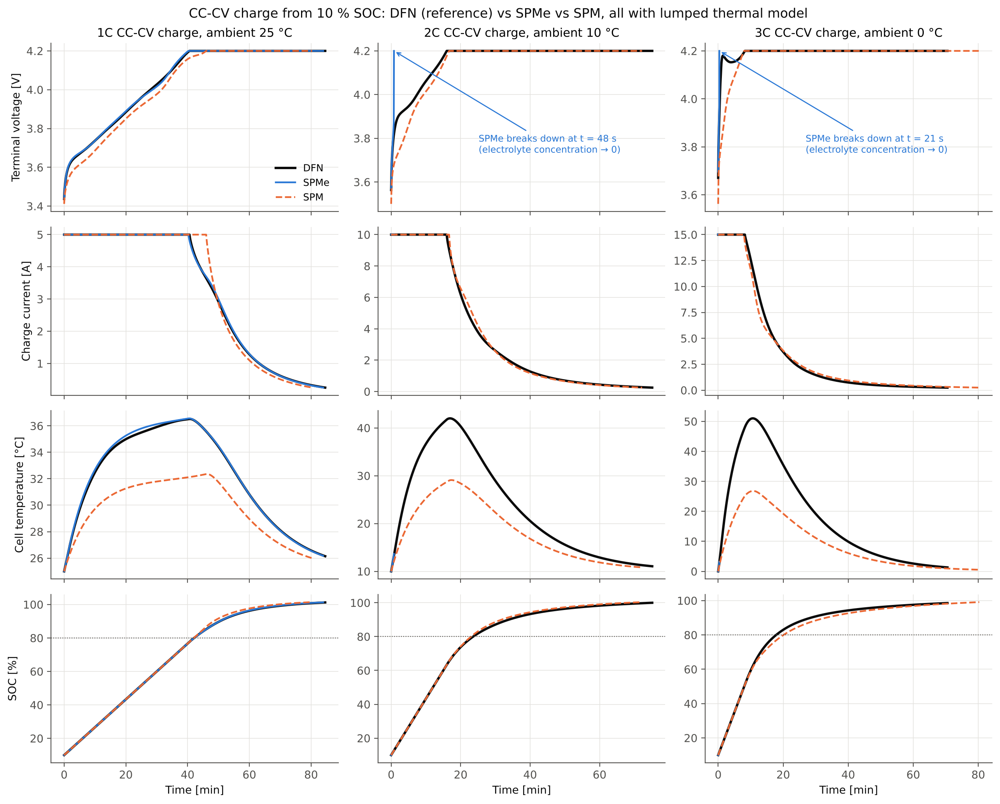

- 1C/25 °C：SPMe（蓝）和 DFN（黑）几乎重合；SPM（橙）电压偏低，因为没有电解液过电位，所以恒压阶段开始得更晚。
- SPM 产热偏少：1C 时峰值温度 32 °C vs DFN 37 °C；3C/0 °C 时 27 °C vs 51 °C。
- 3C/10 °C 和 3C/0 °C 时 SPMe 在一分钟内就停止了：它算出的电解液浓度降到 0，模型失效。

## 4.2 适用范围图（核心结果）

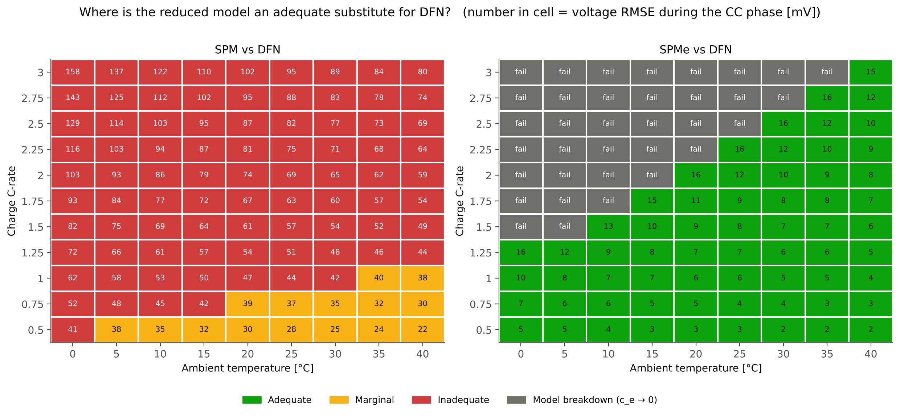

- **SPM**：99 个工况里 0 个适用，15 个勉强（只在 ≤ 1C 而且较暖时），84 个不适用。电压 RMSE 22–158 mV。
- **SPMe**：只要能算出来（64 个工况），全部适用，误差 ≤ 16 mV、≤ 0.75 K、80% 时间误差 ≤ 1.6%。但是有 35 个工况“模型失效”（灰色），边界是一条斜线：0 °C 时从 1.5C 开始，25 °C 时从 2.5C 开始，35 °C 时从 3C 开始，40 °C 时 3C 也没问题。
- **SPMe 的失效是“突然”的，不是慢慢变差**：边界旁边的绿色格子误差只有 13–16 mV，再往上一格就直接失效。这对 BMS 很重要：不能靠“误差慢慢增大”来提前发现问题。
- **边界的物理含义**：所有 SPMe 能算的工况，DFN 的最低电解液浓度都 ≥ 158 mol/m³；所有失效的工况都 ≤ 145 mol/m³（初始浓度 1000 mol/m³）。所以判据很简单：**DFN 预测电解液降到初始值的约 15% 以下时，SPMe 失效**。

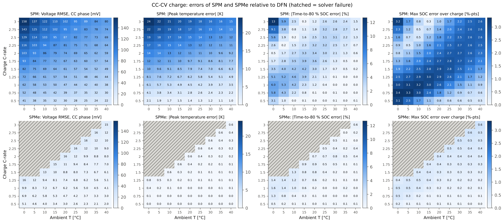

决定 SPM “不适用”的始终是电压误差，但即使只看温度也会判它不适用：ΔT_peak 最高 24 K。充电时间和 SOC 误差反而很小（SPM ≤ 13%，SPMe ≤ 1.6%），因为恒流电流是给定的，恒压段又把电压误差“藏”起来了。

## 4.3 为什么：被“平均”掉的梯度

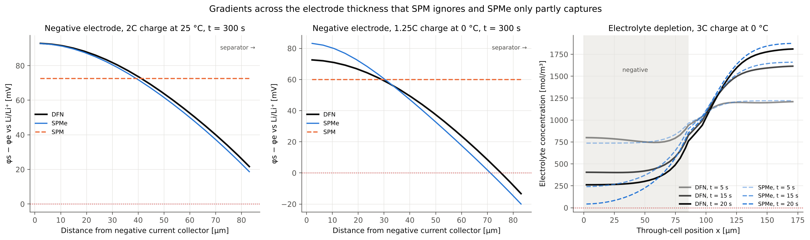

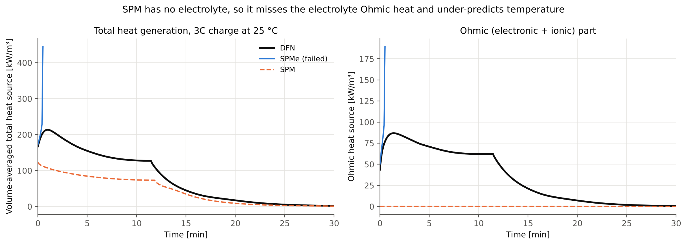

两个机理：

1. **电解液耗尽**：SPMe 假设反应在整个电极厚度上均匀分布，而 DFN 里反应集中在靠隔膜一侧。于是在 SPMe 里，负极靠集流体一侧的电解液浓度会比 DFN 更早降到 0，模型就失效了。
2. **少了产热**：SPM 没有电解液，所以没有电解液欧姆热，也没有电解液浓度过电位带来的不可逆热，总产热少了约三分之一。SPM 算出的电池温度因此偏低，而温度又会反过来影响动力学和传输，所以温度误差在整个充电过程中越积越大。

## 4.4 析锂风险指标

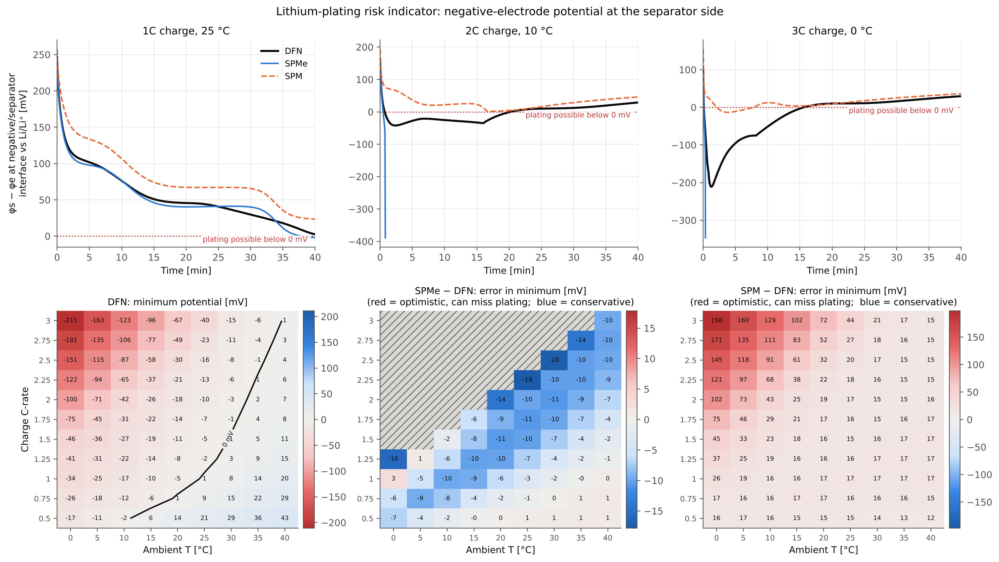

- DFN 在 99 个工况里有 69 个出现 φ_s − φ_e < 0（最低 −211 mV，在 3C/0 °C）。
- **SPM 给出的是电极平均电位，比 DFN 隔膜处的值高 12–198 mV，在 69 个风险工况里有 48 个报告“安全”。** 这是 SPM 不能用于快充安全判断的最直接证据。
- SPMe 与 DFN 差在 18 mV 以内，而且误差方向是“偏保守”（预测的电位更低）：在它能求解的 34 个风险工况里一个也没漏掉，另外有 11 个保守的“误报”。
- 但要注意：SPMe 在最危险的低温高倍率区正好是失效的，所以那里只能用 DFN。

## 4.5 计算成本

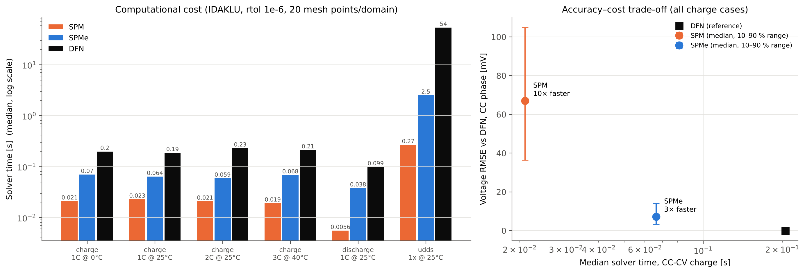

| 工况 | DFN 求解时间 | SPM 加速比 | SPMe 加速比 |
|---|---|---|---|
| CC-CV 充电（4 个工况） | 0.19–0.23 s | 8–11× | 3–4× |
| 1C 恒流放电，25 °C | 0.10 s | 18× | 2.6× |
| UDDS 一个循环（23 分钟），25 °C | 54 s | 约 200× | 约 21× |

- 单次 CC-CV 充电，三个模型都在 0.3 秒以内。算上建模等固定开销，加速比只有约 4×（SPM）和 1.5×（SPMe）。所以**离线研究用 DFN 完全没问题**，加速比对需要大量重复求解的场景（MPC、参数估计、蒙特卡洛）才重要。
- UDDS 工况差距大得多：电流每秒都在变，求解器必须走很小的步长，而 DFN 每一步要解的方程组大得多。

## 4.6 放电和 UDDS 工况

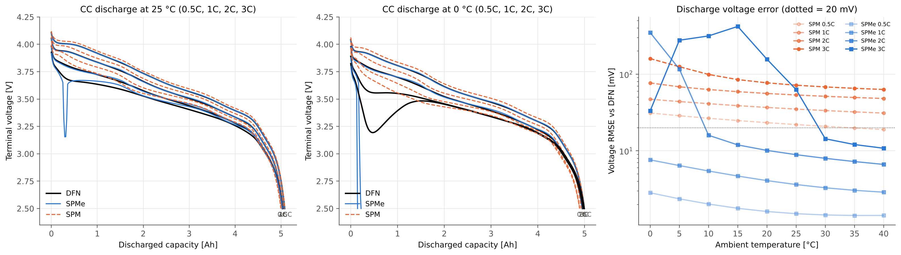

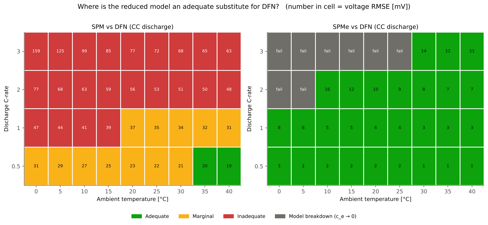

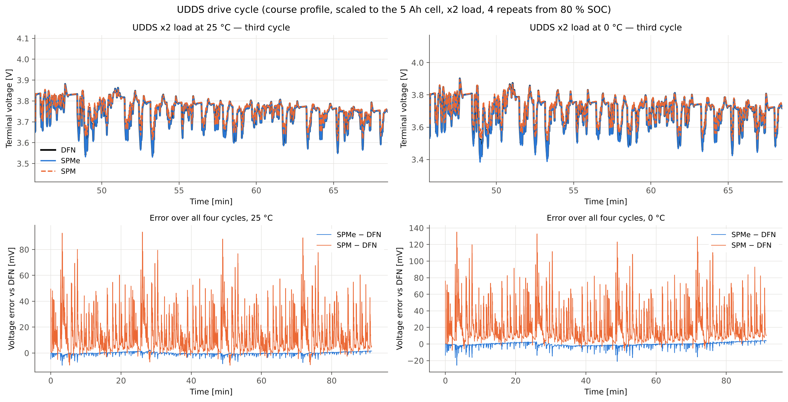

- 恒流放电：结论一样。SPMe 在能算的地方 ≤ 16 mV，但在 2C/3C 低温放电时同样失效（36 个里有 8 个）。SPM 电压误差 19–159 mV，但**放电容量误差 < 2%**，所以只关心容量 / SOC 时 SPM 够用。
- UDDS：平均电流小，SPMe 误差 ≤ 2.7 mV；SPM 8–27 mV，×1 负载下全部适用，×2 负载在 0 °C 和 10 °C 时“勉强”。SPM 的问题是快充这种**持续大电流**，不是所有工况。

## 4.7 冷却敏感性

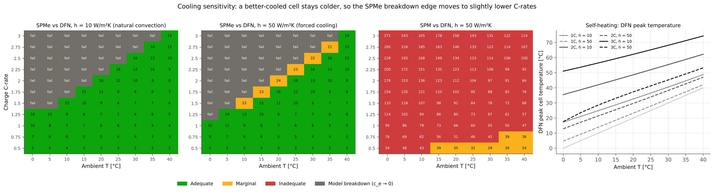

把对流换热系数从 10（自然对流）提高到 50（强制风冷）：

- DFN 峰值温度从 74 °C（3C/40 °C）降到 53 °C。
- 电池更冷 → 电解液传输更慢 → SPMe 失效边界往低倍率移了一点（35 → 36 个失效，外加 6 个“勉强”）。
- SPM 温度误差变小（≤ 8.7 K），但电压误差变大（最高 271 mV）。
- **结论不变**：图会随冷却条件移动，但“SPMe 在电解液耗尽前可用，SPM 不可用”成立。

## 4.8 与 LG M50T 实测数据对比

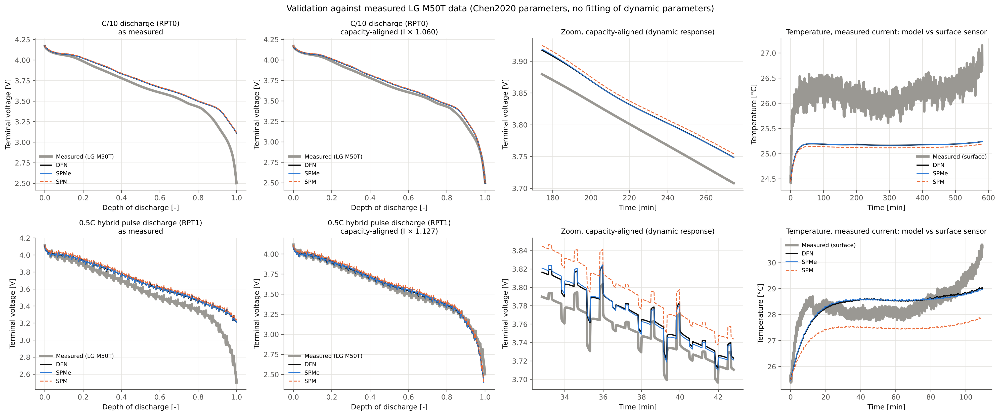

| 电压 RMSE（0–90% DOD）[mV] | C/10 原始 | C/10 对齐 | 脉冲 原始 | 脉冲 对齐 |
|---|---|---|---|---|
| DFN | 67 | 34 | 87 | 24 |
| SPMe | 67 | 34 | 87 | 25 |
| SPM | 72 | 40 | 107 | 46 |

- 原始对比的误差主要来自**容量不同**（5.13 vs 4.85 Ah），容量对齐后 DFN/SPMe 降到 24–34 mV，剩下的主要是开路电压曲线的差别（不同批次的电池），不是模型结构的问题。
- 脉冲响应的形状 DFN/SPMe 和实测吻合；表面温度 RMSE：DFN 0.53 K，SPMe 0.54 K，**SPM 1.09 K（偏低）**，和仿真中“SPM 产热不足”的结论一致。
- 这也说明了为什么本项目以 DFN 为基准做**相对比较**：未标定的参数与具体电池的差别（约 30 mV）和模型结构差别是同一量级的，绝对验证需要标定，那不在方案 A 范围内。

## 4.9 数值检查

- **网格收敛**：DFN 从 20 点加密到 40 点，4 个工况（包括最难的 3C/0 °C）电压 RMSE 变化 ≤ 2.1 mV（恒流段 ≤ 6 mV），峰值温度变化 ≤ 0.05 K，析锂电位最小值变化 ≤ 1.4 mV，远小于 SPM/SPMe 的误差。（`results/mesh_check.csv`）
- 三个模型用相同容差；计时串行重复 5 次。

# 5. 结论：模型选择规则

1. **快充时需要温度或析锂风险？** 不要用 SPM：它低估产热和负极极化。
2. **DFN 的电解液最低浓度会不会降到初始值的约 15% 以下？** 不会 → 用 SPMe：与 DFN 差 ≤ 16 mV 和 1 K，求解快 3–4 倍（行驶工况约 21 倍）。
3. **低温 + 高倍率（灰色区域）？** 用 DFN：SPMe 会突然失效，没有渐变的预警。
4. **只关心容量、SOC，或者温和的行驶工况？** SPM 够用（容量误差 < 2%，×1 UDDS 电压误差 ≤ 15 mV），而且比 DFN 快约 200 倍。

MATLAB 里的 `select_model.m` 实现了这个规则：给定倍率和环境温度，返回最便宜但足够准的模型和原因。

# 6. 局限性（报告里要诚实写）

- 只用了一套参数（Chen2020，初始寿命），没有老化，没有标定。
- 集总热模型：21700 电池芯部和表面的温差没有考虑，大倍率下芯部会更热。
- Arrhenius 活化能来自文献（Ecker 2015、O'Kane 2022），不是这颗电池测的。
- 析锂只是基于电位阈值的风险指标，没有析锂反应模型，不能定量。
- 端电压验证只用了低倍率放电数据；快充实测数据（方案 A 提到的 M50T 1C/3C 和 UDDS 数据）所在网站（Zenodo / Mendeley / OSF）我这边无法访问。
- “适用”阈值（20 mV、2 K、5%）是人为选择的；所有原始误差都在 CSV 里，换阈值只需改 `config.py` 然后 `python run_sweep.py --analyse-only` 重新出图。

# 7. 与原摘要的不一致之处

你原来的摘要承诺了 SEI / 析锂退化建模、退化诊断、可辨识性分析、用容量衰减轨迹和 IC 曲线标定 DFN、析锂速率和衰减拐点预测、以及 15 分钟充到 80% 的多阶段恒流优化——这些方案 A 都没有做。另外原摘要第三句语法不通，而且没提热模型和 UDDS。逐条对照和修改建议在 `docs/Revised_Abstract.md`，新摘要已经填好了所有数字。

一个可以写进 Discussion 的有趣联系：原摘要的目标是“15 分钟充到 80%”。本研究里 DFN 从 10% 充到 80% SOC 在 3C/25 °C 时约 15 分钟（897 s），而 25 °C 下 SPMe 从 2.5C 起就失效了，析锂指标也早已为负。也就是说，**如果以后要做 15 分钟快充优化，必须用 DFN（或改进的 SPMe），不能用 SPM**——这正好可以作为 future work 的引子。

## 7.1 和队友框架的合并

队友的框架（SEI + 析锂退化、容量拐点、15 分钟充电的遗传算法优化）可以和本项目串成一条线：①哪个模型在哪儿可信（本项目，已完成）→ ②快充带来多少退化（队友）→ ③怎样 15 分钟充到 80% 又不析锂（一起做）。合并后的框架图、衔接页和分工表在 `docs/Team_Framework_Merged.pptx`。

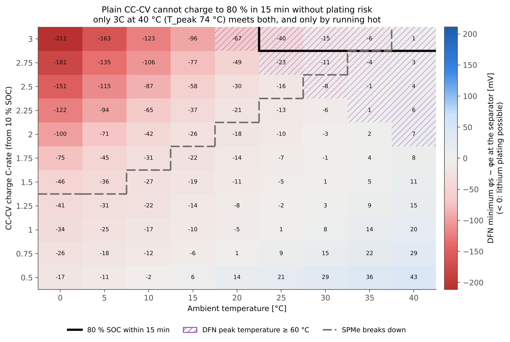

这张图是两部分之间的桥：普通 CC-CV 只有在 3C、25 °C 以上才能 15 分钟充到 80%，但这时负极电位已经小于 0（25 °C 时 −40 mV）。唯一同时满足“15 分钟”和“不析锂”的点是 40 °C 环境下 3C，而电池会热到 74 °C。所以需要按负极电位控制电流的多阶段充电（也就是队友标题里的 anode overpotential control），而且因为这个区域 SPMe 失效、SPM 漏报析锂，优化必须用 DFN。队友做退化时直接用 PyBaMM 的 OKane2022 参数集（就是在 Chen2020 上加了 SEI 和析锂参数），我已经试过 DFN 加 SEI 和部分可逆析锂跑 3C 充电，求解时间 0.4 秒。

# 8. 报告（约 10 页会议论文）建议结构

如果和队友合写一篇论文，按 `Team_Framework_Merged.pptx` 第 3 页的三部分结构写；下面是只写本项目时的结构。

| 章节 | 内容 | 建议用图 / 表 |
|---|---|---|
| Abstract | 用 `Revised_Abstract.md` 的长版或短版 | |
| I. Introduction | 快充的限制（传输、产热、析锂）；降阶模型的需求；文献里很少量化适用范围；本文的研究问题和贡献 | |
| II. Models and Methods | A. DFN/SPMe/SPM 的方程和假设区别；B. 集总热模型和 Arrhenius 参数；C. 工况；D. 误差指标、判定标准和“模型失效”的定义；E. 析锂风险指标；F. 计时方法；G. 实测数据 | 本文 3.3 和 3.4 的两张表 |
| III. Results | A. 实测验证；B. 充电曲线；C. 适用范围图；D. 机理；E. 析锂指标；F. 计算成本；G. 放电和 UDDS；H. 冷却敏感性 | 图 12、图 1、**图 2（必放）**、图 4、图 6、图 7，加上本文 4.5 的计时表 |
| IV. Discussion | 模型选择规则；SPMe 突然失效对 BMS 的意义；与快充优化的联系；局限性 | |
| V. Conclusion & Future Work | 结论 + 退化模型、标定、在 SPMe 适用区内做多阶段充电优化 | |

10 页大概能放 6–7 张图。图 3、图 8–11 可以视篇幅放进附录或者只在 PPT 里用。

演示 20 分钟：PPT 有 17 页，约 1–1.5 分钟一页，每页备注里有中文讲解。

# 9. 你需要做的事

1. 在 PPT 第 1 页核对你的姓名、学号和日期（我写的是 “Yuhui (Joe) Wu · Fall 2026”）。
2. 核实实测数据的出处和引用（`data/m50t/SOURCE.md`）。
3. 下面参考文献的卷号、页码请在引用前核对一遍。
4. 如果能下载到 M50T 的 1C/3C 充电数据，加进 `src/run_validation.py` 顶部的 `DATASETS` 重新跑一下，验证会更有说服力。
5. 如果课程有指定的会议论文模板（如 IEEE），把图和表放进模板即可。

# 10. 如何运行

1. 安装 Python 3.10 以上，在文件夹里运行 `pip install -r requirements.txt`。
2. Windows 双击 `run_all.bat`，或在 `src` 里依次运行：`run_sweep.py` → `run_benchmark.py` → `run_mesh_check.py` → `run_validation.py` → `make_figures.py` → `export_matlab.py`。冷却敏感性：`python run_sweep.py --only charge --h 50`。
3. 快速测试（约 10 秒）：`python run_sweep.py --only charge --quick`。
4. MATLAB：打开 `matlab/SEP798_postprocess.m` 点 Run（读取 `results/matlab/*.mat`）。
5. 全部重跑在 4 核云服务器上大约 40–60 分钟，大部分时间花在 DFN 的 UDDS 仿真上。

# 11. 参考文献（引用前请核对）

1. M. Doyle, T. F. Fuller, J. Newman, “Modeling of galvanostatic charge and discharge of the lithium/polymer/insertion cell,” *J. Electrochem. Soc.*, 140(6), 1526, 1993.
2. S. G. Marquis, V. Sulzer, R. Timms, C. P. Please, S. J. Chapman, “An asymptotic derivation of a single particle model with electrolyte,” *J. Electrochem. Soc.*, 166(15), A3693, 2019.
3. V. Sulzer, S. G. Marquis, R. Timms, M. Robinson, S. J. Chapman, “Python Battery Mathematical Modelling (PyBaMM),” *J. Open Research Software*, 9(1), 14, 2021.
4. C.-H. Chen, F. Brosa Planella, K. O'Regan, D. Gastol, W. D. Widanage, E. Kendrick, “Development of experimental techniques for parameterization of multi-scale lithium-ion battery models,” *J. Electrochem. Soc.*, 167, 080534, 2020.
5. S. E. J. O'Kane et al., “Lithium-ion battery degradation: how to model it,” *Phys. Chem. Chem. Phys.*, 24, 7909, 2022.
6. M. Ecker et al., “Parameterization of a physico-chemical model of a lithium-ion battery I. Determination of parameters,” *J. Electrochem. Soc.*, 162(9), A1836, 2015.
7. A. Nyman, M. Behm, G. Lindbergh, “Electrochemical characterisation and modelling of the mass transport phenomena in LiPF6–EC–EMC electrolyte,” *Electrochim. Acta*, 53, 6356, 2008.
8. F. Brosa Planella et al., “A continuum of physics-based lithium-ion battery models reviewed,” *Prog. Energy*, 4, 042003, 2022.
9. N. Kirkaldy et al., “Lithium-ion battery degradation: comprehensive cycle ageing data and analysis for commercial 21700 cells,” *J. Power Sources*, 2024.（实测数据可能的来源，请核实）
